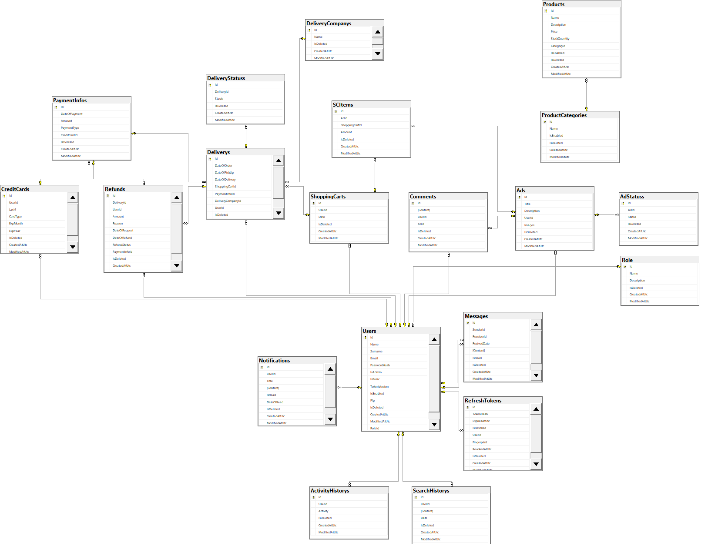
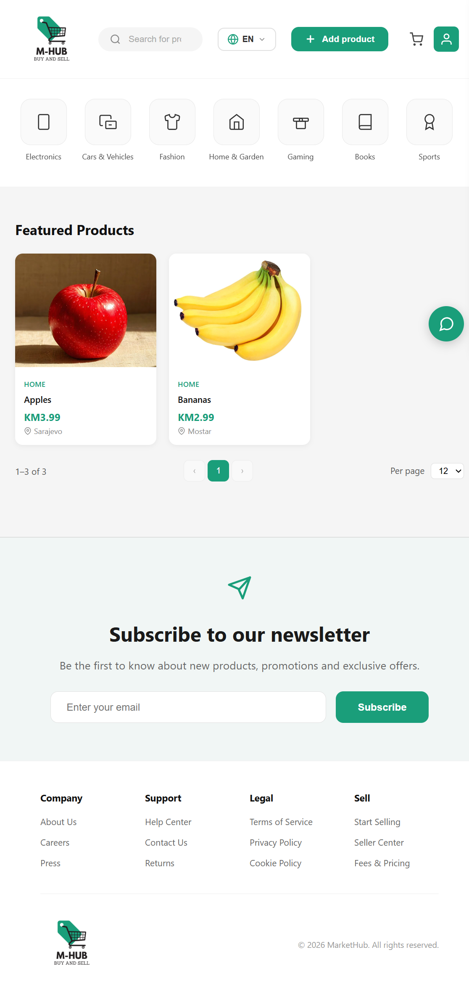
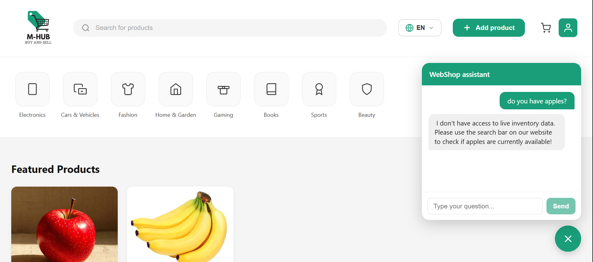
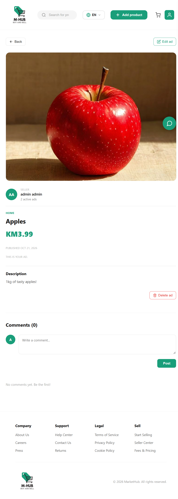
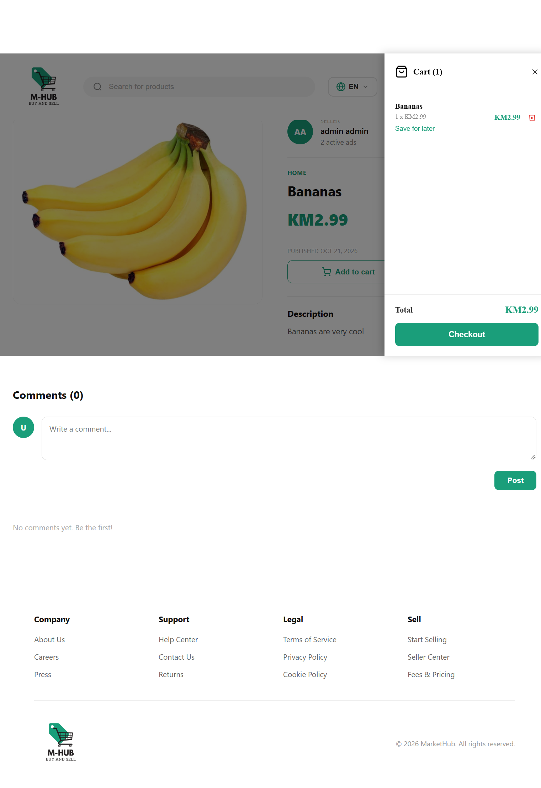
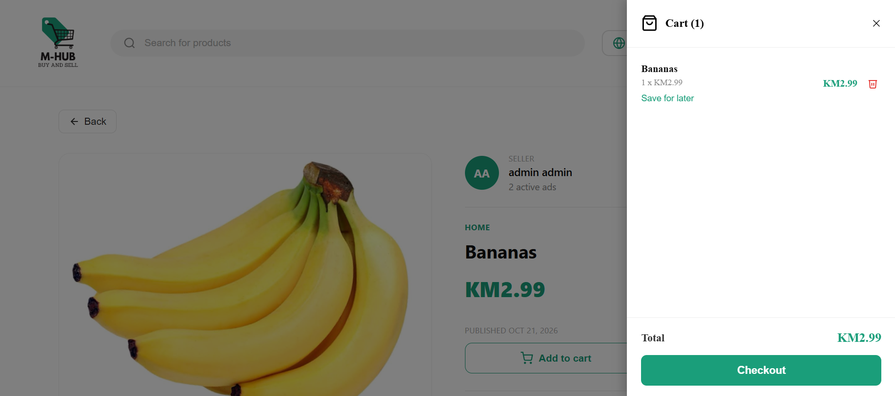
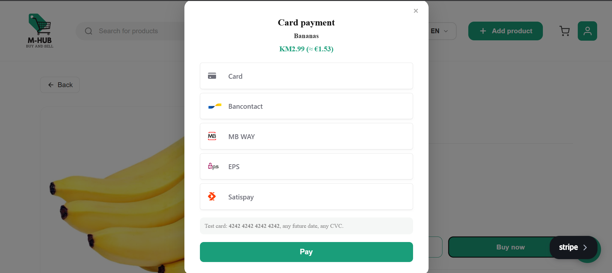
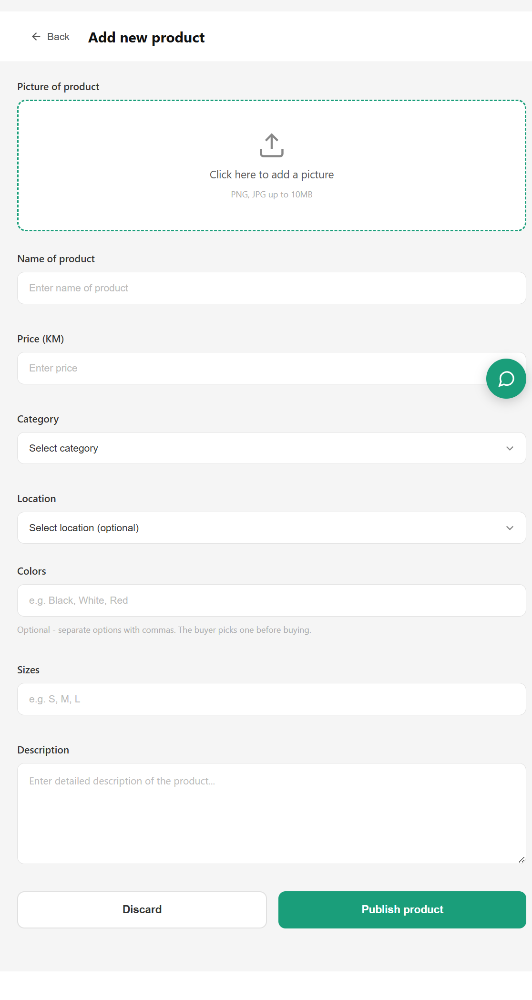
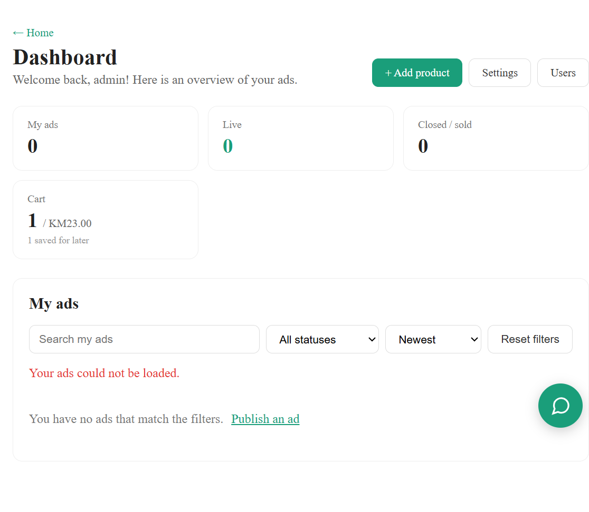
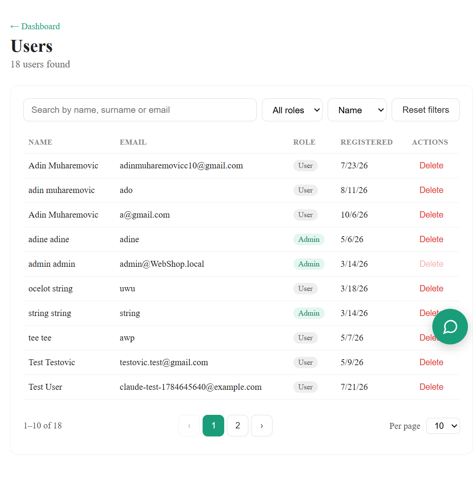

# M-HUB – Online Store (Buy and Sell)

M-HUB is a web application for buying and selling online. Registered users publish product ads; other users browse them, add products to their cart and pay by card through the **Stripe** integration. The application also includes an **AI assistant** (Google Gemini) that answers customer questions, support for two languages (**Bosnian and English**), and an admin area for managing users.

## Purpose

- **Buyers** browse ads by category (Electronics, Cars & Vehicles, Fashion, Home & Garden, Gaming, Books, Sports, Beauty), search for products, leave comments, add products to the cart or save them for later, and pay online.
- **Sellers** publish ads with a picture, price, category, location and options (colors, sizes), and track their ads in the dashboard (live, closed/sold).
- **Administrators** manage users and their roles.

---

## Tech Stack

| Layer | Technologies |
|-------|--------------|
| Frontend | Angular 19, TypeScript, RxJS, ngx-translate (i18n: `bs` / `en`), Stripe.js |
| Backend | ASP.NET Core 8 Web API, MediatR (CQRS), FluentValidation, Entity Framework Core 8 |
| Database | Microsoft SQL Server |
| Authentication | JWT (access + refresh token), BCrypt password hashing |
| Payments | Stripe (Stripe.net + Stripe.js) |
| AI assistant | Google Gemini API |
| Logging | Serilog (console + file), request logging middleware |
| Tests | xUnit, `WebApplicationFactory`, EF Core InMemory |
| API documentation | Swagger (Swashbuckle) |

---

## Architecture

The backend follows **Clean Architecture** principles: dependencies point inward, and the domain layer depends on no other layer. Business logic lives in the Application layer and is split using the **CQRS** pattern (Commands / Queries) with **MediatR**.

```
┌──────────────────────────────────────────────────────────────┐
│                 Angular 19 SPA  (WebShop.Frontend)           │
│  modules (public / client / auth) · api-services · guards    │
│  interceptors (JWT) · chat-widget · stripe-payment-modal     │
└───────────────────────────┬──────────────────────────────────┘
                            │ HTTP / JSON  (JWT Bearer)
┌───────────────────────────▼──────────────────────────────────┐
│  WebShop.API          Controllers, Middleware, Swagger, DI   │
├──────────────────────────────────────────────────────────────┤
│  WebShop.Application  Commands / Queries (MediatR),          │
│                       Validators (FluentValidation),         │
│                       Pipeline Behaviors, Abstractions       │
├──────────────────────────────────────────────────────────────┤
│  WebShop.Infrastructure  EF Core DbContext, Migrations,      │
│                          Seeders, Gemini & Stripe services   │
├──────────────────────────────────────────────────────────────┤
│  WebShop.Domain       Entities (Catalog, Identity, WebShop)  │
│  WebShop.Shared       DTOs, constants, Options classes       │
└───────────────────────────┬──────────────────────────────────┘
                            │
        ┌───────────────────┼────────────────────┐
        ▼                   ▼                    ▼
   SQL Server          Stripe API           Gemini API
```

### Backend projects (`WebShop.Backend/`)

| Project | Responsibility |
|---------|----------------|
| `WebShop.API` | Entry point. REST controllers (Ads, Comment, Payments, User, Chat, Files, Notifications, Messages…), logging middleware, JWT and Swagger configuration. |
| `WebShop.Application` | Business logic as MediatR Commands/Queries (e.g. `Ad/Commands/Create`, `Ad/Queries/List`), FluentValidation validators, pipeline behaviors, interfaces for external services (`IGeminiChatService`…). |
| `WebShop.Domain` | Domain entities grouped into `Catalog`, `Identity` and `WebShopEntities`. |
| `WebShop.Infrastructure` | `DatabaseContext` (EF Core), entity configurations, migrations, seeders and implementations of external services (Gemini, Stripe). |
| `WebShop.Shared` | DTOs, constants and Options classes shared by the other layers. |
| `WebShop.Tests` | Integration and unit tests (Ads, Files, Payment, ProductCategory, User). |

### Request flow

1. An Angular component calls the matching service from `api-services/`.
2. An HTTP interceptor adds the JWT token to the request header.
3. A controller in `WebShop.API` receives the request and sends a Command or Query through `IMediator`.
4. The MediatR pipeline runs validation (FluentValidation), then the handler.
5. The handler reads or writes data in SQL Server through `DatabaseContext` (EF Core), or calls an external service (Stripe, Gemini).
6. The result is returned as a DTO and displayed by the frontend.

### Frontend (`WebShop.Frontend/src/app/`)

| Folder | Contents |
|--------|----------|
| `modules/public` | Public area: home page, product details, layout |
| `modules/client` | Area for signed-in users: dashboard, adding and editing ads, profile, user list (admin) |
| `modules/auth` | Login and registration |
| `api-services` | Services that talk to the backend (ads, auth, chat, comments, payments…) |
| `core` | Shared components (chat widget, Stripe modal, paginator, toast, image crop), guards, interceptors, validators, services (auth, cart) |
| `public/i18n` | Translations `bs.json` and `en.json` |

### Database



---

## Screenshots

### Home page
The header contains search, language selection, an Add product button, the cart and the user profile. Below are the categories and featured products with price and location, followed by pagination, a newsletter signup and the footer.



### AI assistant (WebShop assistant)
A floating chat widget in the bottom-right corner is connected to the Google Gemini API and answers user questions about the store.



### Ad details (owner)
When users open their own ad, they see the picture, seller, category, price, publish date and description, along with **Edit ad** and **Delete ad** buttons. The comments section is below.



### Ad details (buyer) and cart
A buyer can add a product to the cart. The cart opens as a side panel showing the items and total price. Items can be removed or saved for later (**Save for later**), and the **Checkout** button starts the payment.





### Payment (Stripe)
Payment is handled in a Stripe modal with several payment methods (card, Bancontact, MB WAY, EPS, Satispay). The price is shown in KM with an approximate EUR conversion. In test mode, use the card `4242 4242 4242 4242`.



### Adding a new product
The form for publishing an ad: picture (PNG/JPG up to 10 MB, with cropping), name, price in KM, category, location, optional colors and sizes (the buyer picks one before buying) and description. All fields are validated on both the frontend and the backend.



### User dashboard
An overview of the user's own ads: total ads, live ads and closed/sold ads, the cart status, and a list of ads with search, status filter and sorting.



### User management (admin)
The administrator sees a list of all users with search by name, surname or email, a role filter, sorting and pagination, and can delete users.



---

## Getting Started

### Prerequisites
- [.NET 8 SDK](https://dotnet.microsoft.com/download)
- [Node.js](https://nodejs.org/) (LTS) and Angular CLI (`npm i -g @angular/cli`)
- SQL Server (local or Express)

### Backend

```bash
cd WebShop.Backend/WebShop.API

# Secret keys are not stored in the repository – set them with User Secrets:
dotnet user-secrets set "Stripe:SecretKey" "sk_test_..."
dotnet user-secrets set "Stripe:PublishableKey" "pk_test_..."
dotnet user-secrets set "Gemini:ApiKey" "..."

dotnet run
```

The connection string is in `appsettings.json` (`ConnectionStrings:Main`, by default `Server=localhost;Database=WebShopDB`). On startup the database is created and seeded with initial data. The API runs at `http://localhost:5177`, and Swagger at `http://localhost:5177/swagger`.

### Frontend

```bash
cd WebShop.Frontend
npm install
ng serve
```

The application runs at `http://localhost:4200`.

### Tests

```bash
cd WebShop.Backend
dotnet test
```
